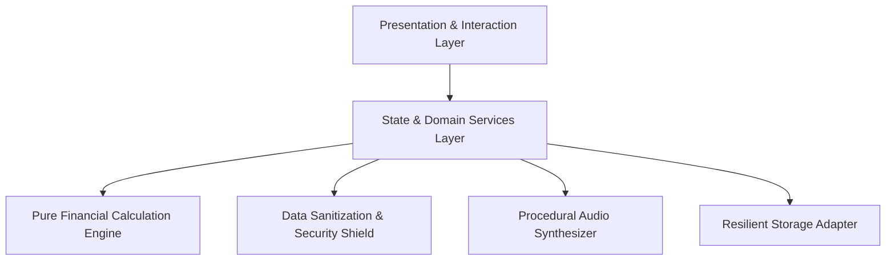

# PAISA.OS — Architecture Specification

## 1. System Overview
**PAISA.OS** is a reactive financial simulation operating system designed for Gen Z budget management. It models a constrained ₹10,000 monthly economy across 30 simulated days with high-consequence interdependent feedback loops.

## 2. Layered Architecture



### A. Presentation Layer (`src/components/`)
* **`StatsOverview`**: High-level KPIs (Liquid Cash, Safe Daily Allowance, Risk Meter, Multi-Factor Health Score).
* **`ForecastChart`**: Real-time SVG predictive cashflow projection across 3 distinct burn rate models.
* **`SimulatorModal`**: "What-If" decision engine computing instant deltas ($\Delta \text{Balance}, \Delta \text{Allowance}, \Delta \text{Risk}$).
* **`ExpenseTracker`**: Discretionary spending input with sanitization and category allocation.
* **`CommitmentsManager`**: Non-negotiable bill reservations (Rent, Mess, Utilities) shielded from impulse spends.
* **`SubscriptionsManager`**: Recurring drains with dynamic daily allowance pause boosts.
* **`SavingsGoalsManager`**: Multi-tiered liquidity reservoirs (Emergency Cushion, Hardware, Bucket-list).
* **`CalendarView`**: 30-day interactive month horizon displaying commitments, subscription renewals, and transaction density.
* **`BrokeModeBanner`**: Emergency austerity protocol triggered dynamically when daily allowance drops below ₹120/day.

### B. State & Context Layer (`src/context/`)
* **`FinanceContext`**: Central state coordinator orchestrating transactions, commitments, goals, and day progression.
* **`AuthContext`**: Manages evaluator persona profiles (Rohan, Ananya, Kabir) and custom credentials.

### C. Pure Calculation Engine (`src/utils/financialEngine.ts`)
* Stateless, side-effect-free pure functions.
* Deterministic financial formulas for daily allowance, multi-factor health grades, and burn forecasting.

### D. Security & Data Sanitization Layer (`src/utils/security.ts`)
* Strips all tags, scripts, and potential XSS vectors.
* Clamps and validates numerical inputs to ensure bounded financial limits.

## 3. Directory Layout
```
├── .github/workflows/deploy.yml   # Automated deployment workflow
├── public/manifest.json           # PWA metadata & web app manifest
├── src/
│   ├── components/                # Presentation widgets & modals
│   ├── context/                   # Reactive state stores
│   ├── data/                      # Initial state & scenario presets
│   ├── types/                     # Strict TypeScript interfaces
│   └── utils/                     # Mathematical engine, audio, security
├── tests/                         # Automated unit & component test suites
├── ARCHITECTURE.md                # System design & layer specifications
├── CONTRIBUTING.md                # Contributor guide
├── LICENSE                        # Open-source MIT License
├── README.md                      # Primary project documentation
└── SECURITY.md                    # Data sanitization & security policy
```
