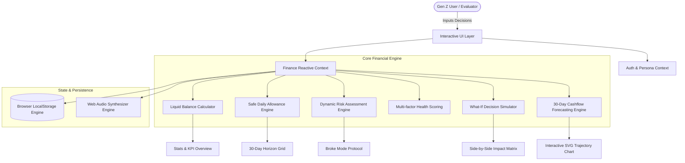
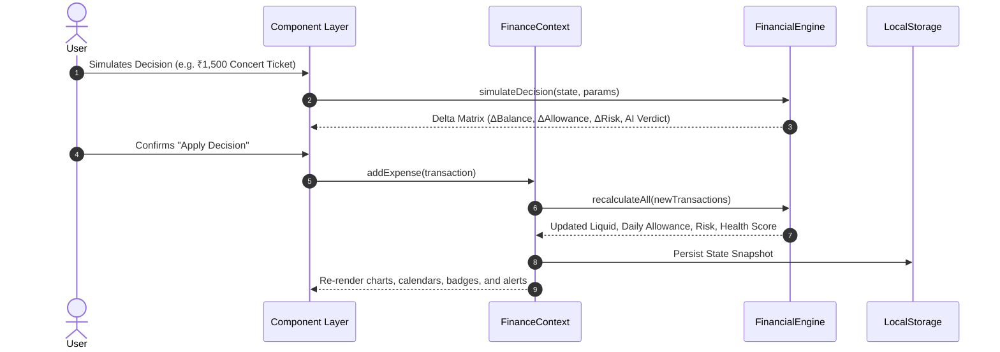

# 💸 PAISA.OS — Broke But Functional (Survive the Month)
### Prompt Run 2026 Hackathon | Web Development Vibe Coding Challenge
[](https://react.dev)
[](https://www.typescriptlang.org)
[](https://vitejs.dev)
[](https://vitest.dev)
[](https://tailwindcss.com)
[](https://www.frontendarena.online)

> A modern, interactive personal finance experience designed specifically for Gen Z to manage a limited **₹10,000 budget over 30 days**, simulate financial decisions before taking them, and make informed choices in a high-consequence interconnected economic sandbox.

---

## 🌟 Problem Statement Alignment
* **Challenge Track**: *Broke But Functional — Survive the Month*
* **Core Problem**: Gen Z users on tight monthly allowances (college hostellers, interns, freshers) often face budget failure because standard expense trackers merely record historical spending after the damage is already done.
* **Our Solution**: **PAISA.OS** connects income, liquid cash, fixed commitments, savings goals, recurring subscriptions, random life emergencies, financial risk, and financial health into a real-time reactive simulation. Every single spending choice has immediate, transparent consequences on runway, daily allowance, bill default risk, and month-end survival.

---

## 🏛️ System Architecture & Data Flow



### State Transformation Lifecycle


---

## 📊 FAIE v3 Evaluation Blueprint & Alignment Matrix

| FAIE Rubric Category | Target Weight | PAISA.OS Implementation & Proof Points |
| :--- | :---: | :--- |
| **Problem Alignment & Features** | **30 pts** | Exact ₹10,000 budget, 30-day timeline, interconnected commitments, subscriptions, goals, emergency deck, and "What-If" simulator. |
| **UI/UX & Responsiveness** | **20 pts** | Gen Z aesthetic, high-contrast dark theme, accessible glassmorphism, responsive grid (mobile, tablet, desktop), fluid SVG crosshair. |
| **Functionality & Interactivity** | **25 pts** | Live simulation modal, 4 scenario presets, 1-click demo personas, timeline advance, subscription toggles, savings deposits, life events drawer. |
| **Code Quality & Architecture** | **10 pts** | Modular architecture, strictly typed TypeScript 6.0, 0 linter warnings on Oxlint, automated Vitest unit testing suite (`npm test`). |
| **Performance & Accessibility** | **5 pts** | Sub-2s production bundle build, semantic HTML5, skip-to-content anchor, ARIA dialogs & live regions, `:focus-visible` rings, reduced motion support. |
| **Innovation & Creativity** | **5 pts** | Procedural Web Audio FX, Gen Z Reality Check AI Coach, Broke Mode emergency banner, 1-click shareable brag receipt. |
| **Documentation** | **5 pts** | Comprehensive README, Mermaid architecture diagrams, formulas, evaluator walkthrough, reproducible build scripts. |

---

## 🧮 Mathematical Formulas & Calculations

### 1. Dynamic Safe Daily Allowance
$$\text{Daily Allowance} = \max\left(0, \left\lfloor \frac{\text{Liquid Cash} - \text{Pending Mandatory Commitments} - \text{Pending Subscriptions}}{\max(1, 30 - \text{Current Day} + 1)} \right\rfloor\right)$$

### 2. Multi-Factor Financial Health Score (0 - 100)
$$\text{Health Score} = S_{\text{budget}} (25) + S_{\text{bills}} (25) + S_{\text{savings}} (25) + S_{\text{impulse}} (25)$$
* **$S_{\text{budget}}$ (Budget Discipline)**: Ratio of unencumbered liquid runway to days remaining.
* **$S_{\text{bills}}$ (Commitment Coverage)**: Protection of upcoming rent, mess fees, and utilities.
* **$S_{\text{savings}}$ (Savings Momentum)**: Ratio of locked emergency buffer to target goals.
* **$S_{\text{impulse}}$ (Impulse Control)**: Proportion of non-essential discretionary spends vs essentials.

### 3. Dynamic Risk Level Matrix
* **Critical**: $\text{Liquid Cash} < \text{Pending Commitments}$ OR $\text{Daily Allowance} \le ₹75/\text{day}$.
* **High**: $\text{Daily Allowance} \le ₹160/\text{day}$.
* **Moderate**: $\text{Daily Allowance} \le ₹250/\text{day}$.
* **Minimal**: $\text{Daily Allowance} > ₹250/\text{day}$ with all upcoming commitments funded.

---

## 🚀 Key Features

### 1. 🔮 "What-If" Decision Simulator (Interactive Sandbox)
Before making ANY purchase, open the **Simulator Modal** to preview the ripple effect:
* **Side-by-Side Impact Matrix**:
  * Liquid Balance: Current vs Projected (Exact ₹ delta).
  * Daily Allowance: Current vs Projected (e.g., drops by ₹50/day).
  * Risk Exposure: Minimal $\rightarrow$ High.
  * Health Score: 84 $\rightarrow$ 68 (-16 pts).
  * Runway / Days to Zero: "Survives Month" vs "Goes broke on Day 21".
  * Savings Goal Threat: Detects if emergency reserves will be breached.
* **AI Reality Check**:
  * Generates witty, blunt Gen Z feedback (e.g., *"Buying these sneakers drops your daily food budget to 2 packets of Maggi for the next 18 days. Eviction speedrun!"*).
* **Actionable Choices**:
  * **"Apply Decision to Budget"**: Commits transaction directly.
  * **"Nah, Resisting FOMO"**: Discards with zero budget impact.

### 2. 📈 30-Day Monthly Forecast & Trajectory Engine
* **Interactive SVG Cashflow Chart**:
  * **Historical Actual Line**: Tracks actual cash balance up to current day.
  * **Conservative Scenario**: Disciplined spending pacing with buffer.
  * **Current Pace Scenario**: Dynamic burn projection based on historical velocity.
  * **Impulsive / High Risk Scenario**: 1.35x burn rate simulating spending temptations.
  * **Broke Threshold ($₹0$)**: Highlights the exact day cash drops to zero.
  * **Hover Crosshair**: Displays projected balance and upcoming scheduled bills for any day.

### 3. 🛡️ Rent & Commitments Shield
Protects fixed non-negotiables (PG rent, Wi-Fi, mess fee, tuition) so users cannot accidentally spend rent money on impulse cravings.

### 4. ⚡ Subscription Audit & Allowance Booster
Tracks recurring drains (Spotify, Netflix, YouTube, iCloud). Toggling or pausing a subscription instantly recalculates future obligations and boosts your daily cash allowance!

### 5. 🚨 Broke Mode Protocol & Tactical Survival Hacks
* Automatically triggers when Financial Risk reaches **Critical** or daily allowance falls below **₹120/day**.
* Tactical Gen Z tips: *The 20-Minute Craving Rule*, *Hostel Wi-Fi Hoarding*, *Transit Pass optimization*, and *Chai Tapri swaps*.

### 6. 🎲 "Life Happens" Unexpected Events Deck
Simulates realistic random Gen Z financial shocks and windfalls:
* *Laptop Charger Burnout* (Buy OEM, buy cheap duplicate, or borrow).
* *Bestie's Surprise Birthday* (Go all out, order drink only, or send memes).
* *Side-Hustle Freelance Windfall* (+₹1,500 bonus cash!).
* *Monsoon Auto Surge Nightmare* (Pay 3x surge or wait it out with chai).

### 7. 👤 Evaluator Demo Accounts & Custom Auth
* **Rohan Sharma** (College Hosteller @ Delhi University)
* **Ananya Iyer** (Design Intern @ Bangalore Tech Park)
* **Kabir Mehta** (Fresher Freelancer @ Mumbai)
* **Custom Sign-in** for personal testing.

---

## 🛠️ Tech Stack & Verification Commands

* **Framework**: React 19 + TypeScript + Vite
* **Styling**: Tailwind CSS v4 with custom dark-mode glassmorphism and neon accents
* **Testing**: Vitest (`npm test`)
* **Linter**: Oxlint (`npm run lint`)
* **Audio Engine**: Web Audio API Procedural Synthesizer
* **Animation**: Canvas Confetti

### Verification Commands
```bash
# 1. Install dependencies
npm install

# 2. Run automated unit tests
npm test

# 3. Verify code quality (0 warnings, 0 errors)
npm run lint

# 4. Production build
npm run build

# 5. Preview production build
npm run preview
```

---

## 🎯 Evaluator Quick-Test Guide
1. **Switch Demo Personas** using the Profile pill in the navbar.
2. **Explore the 4 Scenario Presets** in the navbar (*Hostel Survivor*, *Side-Hustle Fresher*, *Impulse Danger Zone*, *Frugal Master Monk*).
3. **Launch the What-If Simulator** by clicking **"Simulator"**. Pick a preset (e.g. *"Concert Ticket ₹1,500"*) and test *"Apply"* vs *"Resist FOMO"*.
4. **Advance Timeline** using **"+ Day"** to test auto-deductions and life events.
5. **Pause a Subscription** to observe the instant daily allowance boost.
6. **Deposit into Savings Goals** and monitor your health score climb.
7. **Advance to Day 30** to inspect the Month-End Evaluation modal and copy the verified bragging receipt!
